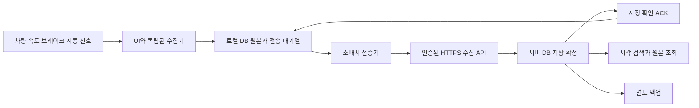

# 페달로그 기능개발서

버전 1.0 · 작성일 2026-11-04 KST · 상태: 개발 기준안

## 1 목적과 이번 결정

페달로그는 브레이크 상태와 차량 속도를 자동으로 기록하고 별도 서버에 계속 동기화하여, 문제가 생겼을 때 사용자가 당시 정보를 확인하는 차량 기록 앱이다. 운행 중 경보를 제공하는 제품이 아니라 기록의 연속성·보존·사후 조회가 중심이다.

사용자 확정 요구사항은 다음과 같다.

- 브레이크와 속도를 핵심 원본 기록으로 남긴다.
- 알람·음성 경고·오조작 판정·차량 제어는 개발 범위에서 제외한다.
- 최초 설정 후 시동/주행 준비 상태에 따라 자동으로 기록을 시작하고 종료한다.
- 별도 저장 서버에 운행 중 계속 전송하고 동기화 상태를 유지한다.
- 문제가 생긴 뒤 원하는 시각의 속도·브레이크 상태와 누락 여부를 확인한다.
- 공모전 서류보다 앱 완성도를 우선한다.

이 문서의 주기·용량·성능 수치는 구현·시험을 위한 **초기 설계 목표**다. Pleos의 실제 지원 사양이나 이미 달성한 성능을 뜻하지 않는다. 저장 서버 위치·운영 비용·최종 보존 기간은 운영 환경 선정 때 확정한다.

## 2 현재 구현과 목표의 차이

| 항목 | 현재 0.2 시제품 | 목표 |
|---|---|---|
| 시작 | 사용자가 버튼 선택 | 최초 동의·권한 설정 후 자동 |
| 실행 수명 | Activity 중심, 화면 이탈 시 중지 | 화면과 독립된 기록 실행 구성 |
| 데이터 | 속도·브레이크 관측, 모의 시나리오 | 실제 차량 원본 관측의 연속 기록 |
| 저장 | 세션 JSONL, 버퍼 기반 기록 | 내구성 있는 로컬 DB 및 전송 대기열 |
| 종료 | 화면 이탈·사용자 중지·30분 제한 | 검증된 시동/전원 이벤트로 세션 마감 |
| 서버 | 없음 | 소유자 인증·수집·조회·백업 서버 |
| 동기화 | 없음 | 실시간 소배치 + 누락 재전송 |
| 조회 | 최근 12초 그래프·파일 분석 | 운행 이력·시각 검색·구간 확대·내보내기 |
| 급가속 로직 | 탐색 이벤트 표시 | 핵심 요건에서 제외, 원본은 조건 없이 기록 |

현재 APK에 자동 기록과 서버 동기화가 구현됐다고 설명하지 않는다. 이 개발서는 기존 앱을 위 목표로 전환하기 위한 기준이다.

## 3 사용자 흐름과 화면

### 3.1 최초 설정

소유자 계정 로그인 → 기기 등록/차량 식별자 연결 → 기록·서버 전송 안내 확인 → 필요한 차량 권한 승인 → 브레이크·속도·시동 상태 지원 진단 → 자동 기록 사용 설정 순으로 진행한다. 이후 매번 앱을 열거나 시작 버튼을 누르게 하지 않는다.

실제 VIN·위치·연락처는 핵심 기록에 필요하지 않으므로 기본 수집하지 않는다. 설치별 임의 기기 ID와 소유자가 지정한 차량 별칭을 사용한다. 가족 공용·다중 차량 이용은 계정별 접근권한으로 구분한다.

### 3.2 운행 중

검증된 주행 준비 상태를 감지하면 기록 세션을 자동 시작한다. 다른 앱을 사용하거나 화면을 끄더라도 승인된 실행 환경에서는 수집과 전송이 이어져야 한다. 정차·신호 대기·속도 0에서도 기록을 계속한다.

앱을 열었을 때만 기록 중/신호 일부 미수신/서버 연결 대기 등 상태를 간단히 표시한다. 소리·진동·팝업으로 운전자에게 경보하지 않는다. OS가 실행을 위해 요구하는 서비스 상태 표시는 플랫폼 요구에 맞춰 별도로 설계하며 운행 경고 기능을 넣지 않는다.

### 3.3 운행 종료

시동/주행 준비 종료가 확인되면 종료 관측을 로컬에 저장하고 세션을 마감한다. 실행 시간이 남는 경우 즉시 마지막 데이터를 보낸다. 전송을 못 끝내도 로컬 대기열은 유지하며 다음 실행 또는 허용된 네트워크 작업에서 재전송한다.

시동이 꺼진 뒤 전원이 사라진 환경에서 계속 수집·통신할 수 있다고 가정하지 않는다. 종료 직전까지의 데이터가 이미 저장·전송되는 구조가 우선이다.

### 3.4 문제 발생 후 조회

소유자가 차량 앱 또는 휴대폰/PC의 서버 조회 화면에서 차량·날짜·시간을 선택한다. 운행 세션과 기록 공백을 확인하고 관심 시각 전후를 확대한다. 초기 화면은 선택 시각 전후 60초, 확대는 10초/1분/10분 단위를 제공한다.

차량 본체를 사용할 수 없어도 서버에 저장 완료된 기록은 계정으로 조회할 수 있어야 한다. 최근 데이터가 서버에 없으면 마지막 서버 저장 시각과 그 이후의 미확인 구간을 명시한다.

| 화면 | 주요 내용 |
|---|---|
| 기록 상태 | 현재 세션, 신호별 수신 상태, 로컬 마지막 저장, 서버 마지막 저장 확인, 미전송 건수 |
| 운행 이력 | 시작/종료/비정상 종료/서버만 확인 가능한 세션, 기록 길이와 공백 |
| 상세 기록 | 속도 곡선, 브레이크 입력·해제·미확인, 시동 상태, 원본 시각과 수신 시각 |
| 구간 검토 | 선택 범위 확대, 원본 값 목록, 신호 품질·동기화 경계 확인 |
| 내보내기 | 선택 구간 JSONL 원본, CSV 조회용 사본, 데이터 설명·해시·불완전 구간 목록 |
| 설정 | 연결 계정/차량 별칭, 자동 기록, 기기 등록 해제, 저장 공간·보존 설정 |

CSV 사본의 시각·단위를 명확히 하고, 수식으로 해석될 수 있는 텍스트는 이스케이프한다. 원본 JSONL에는 해당 변환을 적용하지 않는다.

## 4 기능 요구사항

| ID | 우선순위 | 요구사항 | 완료 조건 |
|---|---|---|---|
| FR-01 | 필수 | 속도 원본 값과 단위·품질 기록 | 지원 신호가 모두 저장되고 원본 부호·시각 보존 |
| FR-02 | 필수 | 브레이크 입력·해제·미확인 기록 | 오류·null·누락을 해제로 치환하지 않음 |
| FR-03 | 필수 | 시동/주행 준비 기반 자동 시작·마감 | 첫 설정 이후 UI 조작 없이 시작·종료 시험 통과 |
| FR-04 | 필수 | UI와 독립된 수집 | 앱 화면 이탈·다른 앱 사용 때 기록 연속성 유지 |
| FR-05 | 필수 | 로컬 내구 저장 | 기록과 전송 대기 등록이 한 트랜잭션으로 확정 |
| FR-06 | 필수 | 운행 중 서버 소배치 전송 | 정상 망에서 정의한 지연 목표 측정·충족 |
| FR-07 | 필수 | 중복 방지·누락 재전송 | 재시도/재시작 후 논리적으로 동일한 기록 1건만 존재 |
| FR-08 | 필수 | 서버 저장 확인 표시 | 단순 HTTP 성공과 영구 저장 완료를 구분 |
| FR-09 | 필수 | 날짜·시각별 원본 조회 | 관심 구간을 브레이크·속도 동일 시간축으로 확인 |
| FR-10 | 필수 | 차량 없이 서버 기록 조회 | 소유자 계정으로 다른 기기에서 접근 가능 |
| FR-11 | 필수 | 기록 공백·종료 불확실성 표시 | 데이터 없음과 속도 0/브레이크 해제가 구분됨 |
| FR-12 | 필수 | 계정·기기별 접근 통제 | 다른 소유자·해제된 기기는 기록 접근 불가 |
| FR-13 | 필수 | DEMO/REAL 분리 | 데모가 실제 운행 이력·전송 통계에 섞이지 않음 |
| FR-14 | 필수 | 기록 구간 내보내기 | 원본·설명·공백·해시를 함께 확보 |
| FR-15 | 후속 | 사건 구간 별도 보존 | 사용자가 지정한 구간을 일반 만료 대상에서 분리 |

가속페달 접근이 가능해지면 선택 신호로 확장할 수 있으나, 브레이크·속도 기록 앱의 선행 조건으로 두지 않는다. 알림이나 오조작 감지 기능을 이 요구사항에 추가하지 않는다.

## 5 시동과 실행 수명

### 5.1 반드시 구분할 상태

차량 시동/READY, 인포테인먼트 전원, Android 부팅, 사용자 잠금 해제, 화면 표시, 앱 프로세스 실행은 서로 다른 상태다. 내연기관의 자동 정차 시 엔진 정지나 전기차의 엔진 부재를 운행 종료로 해석하지 않는다. 속도 0·기어 P·화면 꺼짐만으로도 종료하지 않는다.

AAOS에는 `IGNITION_STATE` 표준 프로퍼티가 있고 읽기 권한은 `Car.PERMISSION_POWERTRAIN`으로 정의돼 있다. 다만 Pleos 탑재 차량이 해당 상태를 일반 앱에 제공하는지, EV READY에 어떤 의미로 대응하는지는 아직 확인하지 않았다. [Google 명세](https://developer.android.com/reference/android/car/VehiclePropertyIds#IGNITION_STATE)

| 상태 | 동작 |
|---|---|
| 설정 미완료 | 자동 수집 안 함. 최초 설정에서 필요한 항목 안내 |
| 기동 대기 | OS/플랫폼이 실행을 허용하면 차량 서비스 연결 및 상태 확인 |
| 기록 중 | 관측 수집·로컬 저장·서버 전송을 병행 |
| 신호 일부 불가 | 가능한 신호를 기록하고 불가 구간/사유를 남김 |
| 시동 상태 불명 | 임의로 ON/OFF 확정하지 않음. 미확인 상태의 잠정 구간으로 분리 |
| 종료 확인 | 종료 이벤트 로컬 확정, 가능할 때 마지막 전송, 자원 해제 |
| 갑작스러운 중단 | 다음 실행 시 미마감 세션 복구 및 중단 공백 표시 |

상태 불명·플랫폼 깨움만 확인된 경우에는 짧은 진단 구간으로 구분한다. 운행 여부를 확인할 수 없으면 무제한 상주하거나 정상 운행 세션으로 표시하지 않는다. 잠정 진단의 시간 한도는 실차 전원 정책 확인 후 설정한다.

### 5.2 자동 실행의 플랫폼 확인

단순 `BOOT_COMPLETED` receiver만으로 자동 기록을 보장하지 않는다. 시동마다 OS가 재부팅되지 않을 수 있으며 suspend 복귀·사용자 전환·서비스 재연결도 검증해야 한다.

일반 앱의 부팅 후 실행, 장시간 수집, 허용 서비스 유형, 전원 이벤트 접근은 Pleos 지원팀 확인과 대상 OS 시험이 필요하다. AAOS 내부 전원 관리 문서의 모든 시스템 콜백을 일반 앱이 사용할 수 있다고 가정하지 않는다. [AAOS 전원 수명](https://source.android.com/docs/automotive/power/power), [Pleos 실행 모델](https://document.pleos.ai/docs/pleos-only/vehicle-app-planning-guide/app-structure-screen-model)

예를 들어 Android 15를 타깃하는 앱에는 `dataSync` 전면 서비스의 장시간 실행과 부팅 이벤트 시작 제한이 있다. 따라서 수집기를 무기한 `dataSync` 서비스로 선언하는 설계를 채택하지 않는다. 대상 Pleos OS·권한·승인된 실행 방식에 맞춰 수집 서비스와 재전송 작업을 나눈다. 주기 작업은 미전송 복구용이며 고주기 수집기의 대체물이 아니다. [Android 실행 제한](https://developer.android.com/about/versions/15/behavior-changes-15)

자동 실행이 승인되지 않으면 해당 배포 경로에서는 필수 요건 미충족이다. 수동 시작이 되는 시연을 자동 기록 완성으로 보고하지 않는다.

## 6 수집과 시간 정보

### 6.1 초기 수집 목표

- 속도: 가능하면 10Hz 구독 요청. 실제 제공률·갱신률을 별도로 측정하고 지원 범위에 맞춘다.
- 브레이크: 상태 변화 콜백을 원본 그대로 저장하고, 초기에는 500ms 조회로 연결 상태를 함께 확인한다. 실제 관측 시각 정밀도는 별도 평가한다.
- 시동/전원/서비스 연결: 변화 이벤트와 수신 상태 기록.
- 수신기 상태: 기록 서비스·동기화·저장 공간의 주기 상태와 오류 이력.

현재 Pleos 브레이크 API는 Boolean과 조회/구독 인터페이스를 제공하지만 원본 차량 타임스탬프는 콜백 인자로 확인되지 않았다. 서버로 더 빨리 보낸다고 페달 관측의 시간 정확도가 개선되는 것은 아니다. 변화 콜백과 조회 결과는 서로 다른 관측 유형으로 남기며, 중복 조회를 새로운 물리적 페달 변화로 세지 않는다.

### 6.2 시각 필드

| 필드 | 의미 |
|---|---|
| `source_time_ns` | 차량 API가 제공한 원본 시각. 없으면 null |
| `source_clock` | 원본 시계의 종류와 clock-domain 식별자. 모르면 UNKNOWN |
| `received_elapsed_ns` | 콜백 진입/조회 응답 때 앱이 측정한 단조 증가 시각 |
| `observed_utc` | 앱 벽시계 기준 표시용 UTC. 정확성은 별도 상태로 표시 |
| `persisted_utc` | 로컬 트랜잭션 저장 시각 |
| `server_received_utc` | 서버 수신 시각 |
| `server_committed_utc` | 서버 저장 트랜잭션 확정 시각 |

부팅마다 `boot_id`를 새로 만들며 다른 부팅의 elapsed 값끼리 직접 빼지 않는다. UTC와 단조 시각의 기준점을 함께 기록하고 벽시계가 바뀌면 `CLOCK_ANCHOR_CHANGED`를 남긴다. 서버 수신 시간을 페달이 눌린 시각으로 사용하지 않는다.

차량 원본 시계가 앱 monotonic과 다르면 명시적으로 매핑하거나 원본 축으로 따로 보여준다. 시계 도메인을 확인하지 못한 값을 억지로 정렬하지 않는다. 브레이크 원본 시각이 없으면 조회 화면과 내보내기에 ‘앱 수신 시각 기준’을 표시한다.

### 6.3 품질과 원본 보존

원본 관측은 `AVAILABLE / NULL_VALUE / API_ERROR / PERMISSION_DENIED / DISCONNECTED` 등 수집 결과와 관측 유형을 가진다. 조회용 상태에서는 별도로 `UNKNOWN / STALE / LAST_OBSERVED`를 구분한다.

콜백이 변화 때만 오는 경우 값이 유지되는 구간과 연결 두절을 구분하기 위해 조회·연결 상태를 참고한다. 조회 응답이 빠르더라도 차량 내부 캐시 최신성은 모를 수 있으므로 `freshness_basis=receipt_only`를 보존한다. 보간·직전 값 유지·다운샘플은 조회용 파생 정보로만 만들며 원본을 덮어쓰지 않는다.

기록 공백, 앱 미실행, 서비스 미연결, 권한 거부, 저장 실패를 별도 사건으로 남긴다. 원본 샘플을 만들지 못한 공백은 서버 조회에서도 빈 구간으로 남긴다.

## 7 저장과 동기화 구조



### 7.1 로컬 저장

Android SQLite 기반 DB를 사용한다. 초기 후보는 Room이며 최종 라이브러리 버전은 구현 시 고정한다. UI가 DB나 네트워크를 직접 소유하지 않도록 수집기·저장소·전송기·조회 화면을 분리한다.

샘플과 outbox는 **동일 DB 트랜잭션**으로 저장한다. 초기 flush 상한 목표는 100ms다. 메모리 큐에만 있는 값은 아직 저장된 것으로 표시하지 않는다. WAL 및 내구성 설정을 실제 장애 시험으로 검증하고, 기본 설정만으로 전원 차단 내구성을 단정하지 않는다.

프로세스가 죽으면 마지막 확정 sequence부터 복구한다. 새 프로세스는 같은 부팅/시동 상태를 확인한 뒤 기존 운행 세션에 새 기록 segment를 연결하고, 중단 시간은 `PROCESS_RESTART_GAP`으로 표시한다.

시동 종료 이벤트를 받을 때만 flush하는 구조는 금지한다. 화면 이탈을 기록 종료로 취급하는 현재 Activity 구조와 30분 제한도 제품 수집기에서 제거한다. 대신 저장·전원·실행 정책에 따른 명시적 종료 사유를 남긴다.

### 7.2 전송 목표

정상 연결 중 최대 1초 또는 100건 누적 중 먼저 도달하는 조건으로 작은 배치를 보낸다. 기록 빈도가 낮아도 브레이크 변화와 세션 시작/마감은 다음 배치를 기다리지 않고 전송을 깨울 수 있다. 전송기는 최대 1개의 요청을 진행하고 수집은 네트워크를 기다리지 않는다.

초기 목표는 정상 망에서 로컬 저장 확정부터 서버 ACK까지 p95 3초 이내다. p50/p95/p99, 최대 미전송 age, 실제 수신률을 함께 측정한다. 3초는 보장값이 아니며 네트워크 단절에는 적용하지 않는다.

기본 운행 데이터 전송은 응답 확인이 가능한 HTTPS 소배치로 설계한다. 서버 화면의 갱신은 별도 구독/SSE 또는 짧은 조회로 구현할 수 있지만, 실시간 화면 갱신과 원본 저장 완료는 구분한다.

### 7.3 재전송과 ACK

레코드 기본키는 `(device_id, stream_id, seq)`다. `stream_id`와 순번 할당은 로컬에 영구 저장하고 sequence를 재사용하지 않는다. `boot_id`, `session_id`, `segment_id`는 별도 의미를 가진다.

클라이언트는 최소 한 번 전달을 전제로 같은 배치를 재전송한다. 서버는 기본키와 내용 해시를 비교해 같은 레코드는 중복 저장하지 않는다. 같은 키에 다른 내용이 오면 충돌로 보존·격리하고 오류를 반환한다.

서버는 원본과 수신 메타데이터를 DB에 확정한 뒤 ACK한다. 메모리 큐 투입·프록시의 202 응답만으로 로컬 데이터를 완료 처리하지 않는다. ACK 이후 서버 장애에서도 복구할 내구성 구성을 운영 시험으로 확인한다.

ACK에는 현재 stream에서 연속 확정된 최대 순번 `committed_through_seq`를 포함한다. 건너뛴 구간이 있으면 높은 마지막 순번만 보고 전부 완료 처리하지 않는다. 미확정 순번부터 재전송한다.

서버 저장 직후 응답이 유실되거나 앱이 ACK 반영 전에 죽어도 재전송으로 복구하며 중복은 허용하지 않는다. 영구적으로 처리할 수 없는 레코드는 원인을 표시하고 보존한다. 조용히 폐기해 cursor를 넘기지 않는다.

### 7.4 장애 처리

| 상황 | 요구 동작 |
|---|---|
| 망 끊김 | 로컬 수집 유지, 대기열 축적, 연결 복구 후 순서대로 재전송 |
| timeout/서버 5xx | 지수 backoff와 jitter, 최대 60초 대기. 신규 수집은 계속 |
| 429 | 서버 Retry-After 존중 |
| 401/403 | 무한 인증 재시도 중지, 로컬 보존, 다음 설정 화면에 연결 조치 표시 |
| 일부 순번 누락 | 서버 cursor 앞 공백부터 복구, 뒤쪽 수신과 별도로 관리 |
| 시동 종료/전원 상실 | 종료 flush는 최선 시도, 미전송 상태는 다음 실행에 복구 |
| 서버 재기동 | 내구 저장된 ACK 경계부터 정상 조회·중복 제거 유지 |
| 기기 저장소 파손 | 서버 ACK 완료 구간까지만 복구 가능. 미전송 구간은 복구 보장 불가 |
| 서버 다운 | 화면상 수집 상태와 동기화 지연을 분리. 기록을 동기화 성공으로 표시하지 않음 |

차량과 로컬 저장소가 동시에 손상되고 망이 없었던 미전송 구간은 서버로 복원할 수 없다. ‘실시간 동기화’가 완전한 무손실을 의미한다고 약속하지 않는다. 최근 확정 경계와 누락 가능 구간을 보여주는 것이 필수다.

## 8 데이터와 서버 API 계약 초안

### 8.1 원본 레코드

```json
{
  "schema_version": 1,
  "mode": "REAL",
  "device_id": "random-install-id",
  "stream_id": "durable-stream-id",
  "seq": "1052",
  "boot_id": "boot-id",
  "session_id": "ignition-session-id",
  "segment_id": "recorder-process-segment",
  "signal": "BRAKE_PEDAL",
  "observation_type": "CHANGE_CALLBACK",
  "value": true,
  "unit": "boolean",
  "source_time_ns": null,
  "source_clock": "UNKNOWN",
  "received_elapsed_ns": "123456789000",
  "observed_utc": "2026-11-04T03:00:00.000Z",
  "quality": "AVAILABLE",
  "freshness_basis": "receipt_only"
}
```

속도는 `signal=VEHICLE_SPEED`, 원본 단위 m/s와 부호 있는 값을 보존한다. 화면에서 km/h와 진행 방향을 파생한다. 브레이크 null/오류에는 값 null과 오류 품질을 사용한다. 위 값은 계약 설명용 예시이며 실차 수신 결과가 아니다.

전송 JSON에서 seq와 nanosecond 정수는 10진 문자열로 표현하여 웹 조회의 JavaScript 숫자 정밀도 손실을 방지한다. DB에서는 범위를 검증한 정수로 저장한다. 브레이크는 Boolean/null, 속도는 유한 숫자만 허용한다. 내용 해시에는 서버가 추가한 수신 시각을 포함하지 않으며 동일성 비교의 정규화 규칙을 API 구현 전에 고정한다.

주요 서버 테이블은 owner, device, recording_session, recording_segment, raw_record, ingest_batch, stream_cursor, clock_anchor, record_gap, export_job, access_audit로 나눈다. 시간 파티션과 인덱스는 실제 처리량 시험 후 결정한다. 계정과 차량별 접근 범위를 모든 조회에 적용한다.

### 8.2 API

| API | 목적 | 필수 조건 |
|---|---|---|
| `POST /v1/device-enrollments` | 일회용 등록코드로 기기 연결 | 소유자 인증·코드 만료·재사용 방지 |
| `POST /v1/record-batches` | 원본 배치 전송 | 기기 인증, schema/크기 검증, 중복 제거, 저장 후 ACK |
| `GET /v1/streams/{id}/cursor` | 서버 연속 확정 순번 확인 | 해당 기기/소유자만 접근 |
| `GET /v1/devices/{id}/sessions` | 날짜별 기록 이력 | 소유자 권한·페이지 제한 |
| `GET /v1/sessions/{id}/records` | 시각·순번 구간 원본 조회 | 조회 범위 제한, 기준 시계 명시 |
| `GET /v1/devices/{id}/sync-status` | 마지막 ACK와 수신 상태 | heartbeat와 차량 ON/OFF를 구분 |
| `POST /v1/exports` | 선택 구간 내보내기 생성 | 소유자 인증·감사 기록·유효기간 |
| `POST /v1/retention-holds` | 관심 구간 보존 지정 | 후속 기능, 무제한 생성 방지 |

배치는 초기 최대 100건/256KiB로 제한하고 압축 해제 후 크기도 제한한다. 요청의 device_id를 그대로 신뢰하지 않고 인증된 기기와 대조한다. 실차 전송에는 기기별 폐기 가능한 자격을 사용하고 서버 관리자 키나 Gitea 토큰을 APK에 넣지 않는다.

서버 ACK 예시는 다음과 같다.

```json
{
  "stream_id": "durable-stream-id",
  "committed_through_seq": "1052",
  "inserted_count": 98,
  "duplicate_count": 2,
  "server_committed_utc": "2026-11-04T03:00:01.000Z"
}
```

원본의 seq 1051이 빠졌으면 1052가 수신됐어도 연속 확정 값은 1050 이하로 유지한다. 배치 내 malformed 값은 기본적으로 전체 트랜잭션을 거부하여 부분 성공 해석을 단순화한다. 이미 확정된 동일 레코드의 중복은 정상 처리한다.

## 9 사후 조회와 기록 신뢰성

브레이크를 입력/해제/미확인의 단계 그래프로 표시하고 속도와 함께 확대할 수 있게 한다. 원본이 없거나 신호가 오래된 구간을 색과 패턴으로 구분한다. 서버 데이터가 없다고 속도 0이나 브레이크 해제로 표시하지 않는다.

넓은 구간은 조회용 다운샘플을 사용하되 원본을 보존하고, 브레이크 상태 변화와 데이터 공백은 집계로 사라지지 않게 한다. 확대 시 원본 샘플을 조회한다. 브레이크 원본 시각이 없으면 같은 그림에서도 속도 원본 축과 브레이크 수신 축의 차이를 설명한다.

조회 결과에는 데이터 범위·마지막 서버 확정 순번·실제 수신률·오류/공백·시계 변경·비정상 종료를 포함한다. 서버가 마지막으로 연락받은 시각만으로 차량 시동 OFF나 사고를 추정하지 않는다.

서버 원본은 수신 이후 직접 수정하지 않고 정정·삭제·보존 요청 이력을 별도로 남긴다. 내보내기 해시는 변형 여부 확인을 돕는 수단이며, 센서 정확성·운전자 의도·법적 증거 능력을 보증하지 않는다.

## 10 운영과 보존 기준안

서버는 앱과 별도 배포한다. 기준 구성안은 HTTPS 수집/조회 API, 트랜잭션 DB, 인증, 백업 저장소다. DB 후보는 PostgreSQL이며 FastAPI 등 API 구현 기술·호스팅 위치는 기존 운영 환경을 확인한 뒤 선정한다. 이 문서만으로 서버를 배포하거나 실제 차량 정보를 전송하지 않는다.

- 서버 일반 원본 보존: 초기 90일 제안. 계정별 보존 설정과 만료 안내 제공.
- 로컬 확인 완료 기록: 최대 14일 또는 1GiB 예산 내에서 오래된 ACK 완료 구간부터 정리.
- 미전송 기록: 자동 순환 삭제 대상에서 제외. 한도 근접 시 ACK 완료 구간 우선 정리.
- 미전송 데이터만으로 저장 한도를 채운 경우: 예약 공간을 남겨 저장 불가 시작·종료와 공백을 기록. 무제한 보존이나 계속 수집이 가능하다고 표시하지 않음.
- 관심 구간 별도 보존·계정 삭제·기기 해제 후 접근 처리를 정하고, 백업 만료까지의 처리도 문서화.
- 일별 백업과 복구 시험을 둔다. 백업·저장 장애·수집기 장애는 운영자 상태판에서 확인한다. 운전자 경보 기능은 추가하지 않는다.

용량 산정 예: 속도 10Hz + 조회 heartbeat 2Hz, 평균 500B/레코드라면 원본 약 21.6MB/시간이다. 하루 2시간·90일은 기기당 약 3.89GB이며 인덱스·추가 이벤트·백업·압축은 제외한 가정이다. 실제 페이로드와 운행 시간으로 재산정한다.

## 11 개발 순서와 출시 판단

| 단계 | 작업 | 종료 기준 |
|---|---|---|
| M0 | Pleos 자동 실행·시동/READY·브레이크/속도 권한 확인 | 대상 차량/OS별 지원표와 실제 테스트 경로 확보 |
| M1 | UI 분리, 로컬 DB·outbox·재시작 복구 | 네트워크 없이 연속 기록·프로세스 종료 복구 검증 |
| M2 | 서버 수집 API·인증·ACK·중복 제거 | 응답 유실·재시도·서버 재기동에도 순번/내용 일치 |
| M3 | 소배치 전송·오프라인 복구·전원 종료 대응 | 미전송·저장 경계·공백이 일관되게 표시 |
| M4 | 이력·시각 조회·구간 확대·서버 내보내기 | 차량 없이 관심 구간의 원본과 한계를 확인 |
| M5 | 대상 Pleos 환경 장시간·전원·권한 시험 | 필수 FR와 장애 시험 통과, 실제 성능 수치 기록 |

M0의 플랫폼 확인과 M1/M2의 모의 개발은 병행할 수 있다. 그러나 자동 실행·백그라운드 수집·실제 신호를 검증하기 전 제품 완성을 선언하지 않는다. 서버 스택·보존 기간은 초안 선택이며 사용자 운영 환경 확인 전 특정 서비스에 실제 데이터를 적재하지 않는다.

## 12 인수 시험

| ID | 시험 | 통과 기준 |
|---|---|---|
| AT-01 | 최초 설정 후 실제 시동/READY 20회 | 20회 모두 자동 시작. 사용 가능한 ON 신호 확인 후 2초 내 첫 로컬 확정 목표. 실제 시동부터의 공백도 별도 산출 |
| AT-02 | 화면 전환·화면 OFF·잠금/사용자 전환 | 허용 환경에서 수집 유지, 미허용 구간은 표시 |
| AT-03 | 시동 OFF·suspend·복귀·OS 재부팅 | 중복 세션 없이 마감/복구, 시동과 부팅을 혼동하지 않음 |
| AT-04 | 30분 망 차단 후 복구 | 확정된 로컬 데이터 전부 순번 일치, 서버 중복 0건 |
| AT-05 | 서버 저장 직후 ACK 응답 유실 | 재전송 후 단일 원본, cursor 정상 복구 |
| AT-06 | 앱 프로세스 강제 종료 | DB 확정 데이터 유지, 중단 구간 표시, 대기열 복구 |
| AT-07 | 통제된 전원 상실 시험 | 실제 손실 범위를 측정, 확정/미확정 경계 일치 |
| AT-08 | 브레이크 null·권한 거부·연결 해제 | 해제로 치환되지 않고 품질·사유 보존 |
| AT-09 | 원본 시각 역순·시계 변경·재부팅 | 다른 시계를 잘못 이어붙이지 않고 이상 표시 |
| AT-10 | seq 공백·중복·동일 키 다른 내용 | 공백을 건너 ACK하지 않음, 중복 제거, 충돌 격리 |
| AT-11 | 24시간 모의 수집·저장 공간 한도 | 메모리/파일 무한 증가 없음, 미전송 자동 삭제 없음 |
| AT-12 | 서버 재기동·백업 복원 | 이미 ACK한 범위와 백업 복구 범위의 차이 검증·기록 |
| AT-13 | 다른 계정·해제된 기기 접근 | 수집/조회/내보내기 모두 거부 |
| AT-14 | 서버 단독 구간 조회 | 차량 없이 원본·공백·시각 기준 확인 |
| AT-15 | 정상 망 지연 시험 | 정의한 p95 목표 평가, 실제 갱신률과 지연 분리 측정 |
| AT-16 | 같은 사용자의 DEMO와 REAL | 저장 영역·조회·통계가 분리되고 출처 표시 |

전원 상실·시동 시험은 정차/통제된 검증 환경에서 수행하며 실제 도로에서 위험 상황을 재현하지 않는다.

## 13 이번 설계에서 먼저 해결할 질문

1. 일반 앱이 Pleos에서 시동/READY 또는 이에 준하는 자동 시작 신호를 받고, suspend 복귀와 사용자 전환 후에도 실행될 수 있는가?
2. 브레이크 Boolean·속도 원본의 실제 지원률과 최신성·원본 시계·전달 지연은 무엇인가?
3. 기록 서비스의 장시간 실행·시동 종료 정리 시간이 플랫폼 정책상 허용되는가?
4. 저장 서버를 어느 환경에 운영하고 누가 계정·보존·백업을 관리할 것인가?

1~3은 제품 성립의 플랫폼 조건이다. 4는 배포 전 확정할 운영 조건이다. 문의 초안은 `submission/TECHNICAL_INQUIRY.md`에 있으며 외부 발송은 아직 하지 않았다.

## 14 공식 참고

- [Pleos API 가용성](https://document.pleos.ai/docs/pleos-only/vehicle-app-planning-guide/api-compatibility-availability): 차량별 지원·접근 차이.
- [Pleos 앱 실행 모델](https://document.pleos.ai/docs/pleos-only/vehicle-app-planning-guide/app-structure-screen-model): 화면과 백그라운드 실행의 구분.
- [Pleos Brake API](https://document.pleos.ai/docs/pleos-only/connect-sdk-pleos/Vehicle/vehicle/ai.pleos.playground.vehicle.api/brake/entry): 브레이크 조회·구독.
- [Pleos 속도 조회](https://document.pleos.ai/docs/pleos-only/vehicle-app-developer-guide/vehicle-app-faq): AAOS 속도 접근 안내.
- [AAOS ignition](https://developer.android.com/reference/android/car/VehiclePropertyIds#IGNITION_STATE): 시동 프로퍼티 정의·권한.
- [AAOS 전원 관리](https://source.android.com/docs/automotive/power/power): 전원 전이와 종료/복귀.
- [Android 15 실행 제한](https://developer.android.com/about/versions/15/behavior-changes-15): 특정 서비스의 부팅 시작 및 실행 시간 제한. 적용 OS·타깃 조건 확인 필요.

참고 자료가 존재한다는 사실은 Pleos 실차 권한·자동 실행 승인을 의미하지 않는다. 위 설계 결정과 수치는 개발 계획이며 시험 결과로 갱신한다.

## 15 1차 데모의 네이티브 화면과 간편가입

2026-11-04 사용자 결정: 화면은 유려한 Android 네이티브 UI로 만들며 카카오와 네이버 간편가입을 지원한다.
1차 데모에서는 실제 인증 연결이 없어도 된다. 화면 계층은 Kotlin/Jetpack Compose와 Material3를 사용하고,
기존 Java 기록기·Pleos 연결·관측 데이터는 연결 인터페이스를 통해 유지하고 시간축은 Compose Canvas로 그린다. 웹 개발은 보류한다.

- 기록 상태: 큰 속도 표시, 브레이크 3상태, 로컬 기록 상태, 서버 미연결 표시.
- 운행 이력: 기기 내 실제 원본 파일 목록과 원본 내보내기.
- 설정: 기기·서버 구현 상태, 진단 도구, 글꼴 및 UI 오픈소스 고지.
- 내 계정: 카카오/네이버 선택 → 데모 동의 화면 → 체험 계정 → 로그아웃.
- 필수 두 항목을 선택하기 전에는 시작 버튼을 비활성화한다. 선택 항목은 기본 해제다.
- 동의 화면은 실제 약관·법적 동의·실제 회원 등록이 아님을 표시한다.
- 데모에서는 제공자 이름만 `demo_profile`에 저장한다. 실제 계정 식별자·이메일·비밀번호·토큰을 생성/수집/전송하지 않는다.
- 앱 재시작 후 체험 상태를 유지하며 로그아웃하면 체험 프로필만 해제한다. 로컬 기록은 삭제하지 않는다.
- 계정 없이 기기 기록 화면을 사용할 수 있다. 데모 프로필을 FR-12의 실제 인증·소유권 증명으로 취급하지 않는다.
- 실제 서비스 연결은 각 제공자의 앱 등록과 네이티브 인증 연동, 서버의 토큰 검증, 내부 사용자/기기 매핑을 완료한 뒤 별도 검증한다.

공식 실제 연동 참고: [카카오 Android 로그인](https://developers.kakao.com/docs/ko/kakaologin/android),
[네이버 Android 로그인](https://developers.naver.com/docs/login/android/android.md).
이번 데모에는 두 제공자의 인증 SDK나 실제 외부 로그인 호출을 도입하지 않는다.

## 16 첫 실행·화면 선택·기기 기록 조회 개선

2026-11-04 사용자 요구에 따라 다음을 앱의 필수 UX로 추가한다.

- 첫 실행에 3단계 안내를 제공하고 가입/가입 없이 시작을 선택한다. 건너뛰기·뒤로 가기와 안내 다시 보기를 제공한다.
- 홈에 `체험 기록 시작`과 `차량 연결`을 직접 표시한다. 진행 시간·기록 항목 수·완료 후 조회 동작이 보여야 한다.
- 체험은 기존 기록기로 실제 DEMO JSONL을 생성한다. 대시보드에 숫자만 재생하고 저장한 것으로 표시하지 않는다.
- 기록 종료 후 `방금 기록 보기`로 실제 파일을 비동기로 읽는다. 시간축·선택 시점의 속도·브레이크·시점 슬라이더·1초 이동과 원본 내보내기를 제공한다.
- 상세 미리보기는 최대 32MiB/100,002항목으로 제한한다. 미확인/오래된 값은 0이나 해제로 바꾸지 않는다. JSON 손상·역순 시각·DEMO/REAL 혼합은 읽기 오류로 표시한다.
- 테마는 라이트/다크/기기 설정 따르기 중 사용자가 선택한다. 기본은 기기 설정이며 선택은 `app_experience`에 보존한다.
- 설정 변경은 앱 재실행 없이 적용한다. 명시적 라이트/다크 선택은 기기 테마보다 우선한다. 기기 설정 따르기는 OS 변경에 맞춰 자동 전환한다.
- 테마는 모든 앱 화면과 가입 동의 시트·기록 상세·시간축·네이티브 안내 창·상태/탐색 바에 적용한다. 브랜드 식별 색상은 유지한다.
- `uiMode` 변경만으로 Activity를 재생성해 진행 중 기록을 중단하지 않도록 처리한다. 다른 화면 이탈/백그라운드 수집 제한은 기존 상태와 별도로 검증한다.

이 개선은 기존 자동 시동/서버 동기화의 구현 완료를 뜻하지 않는다. 1차 가입 데모의 외부 인증 미연결 범위는 유지한다.

## 17. 캐릭터 제품 소개 · 0.6

- 최초 실행 시 약 1초의 브랜드 인트로 후 제품 설명 3장면을 보여준다. 기록 대상 → 시점별 조회 → 체험 시작 순서다.
- 사용자 첨부 이미지의 따뜻한 여우 느낌을 참고해 새 3D 렌더 스타일 이미지를 생성했다. 원본 첨부 이미지는 앱에 포함하지 않는다. 생성 PNG·프롬프트·해시는 assets/intro에 보존한다. 편집 가능한 3D 모델·실시간 3D 렌더링은 아니다.
- 네이티브 화면 전환과 부드러운 캐릭터 이동을 적용한다. 시스템 애니메이션 비활성 설정 시 캐릭터 이동은 중지한다. 런타임 외부 이미지/API 의존성이 없다.
- 미리보기 수치와 그래프는 예시 데이터로 표시하며 실제 수집·저장 성공으로 취급하지 않는다.
- 건너뛰기·이전·진행 단계 선택, 라이트/다크/기기 설정 메뉴, 10초 체험·가입 데모 진입을 제공한다. 완료 상태와 진행 단계는 기기에 보존한다.
- 기존 사용자도 0.6의 새 소개를 한 번 보며 이후에는 반복하지 않는다. 설정의 처음 안내 다시 보기에서 재진입할 수 있다.
- 작은 세로 화면은 내용 영역을 스크롤하고 버튼 영역을 고정한다. 차량 가로 화면은 설명과 캐릭터를 나란히 배치한다.
- 자동 시동 수집·서버 동기화·실제 인증의 미구현 상태를 소개에서 숨기지 않는다.

## 18. 일반 사용자를 위한 기록 조회 · 0.7

- 홈은 지난 기록 보기와 현재 기록 상태를 우선 표시한다. 기본 화면에 빈 그래프·개발용 진단·기록 항목 수를 배치하지 않는다.
- 운행 이력을 지난 기록으로 부른다. 실제 기록 시작 시각으로 날짜별 묶음과 오전/오후 시간을 표시한다. 파일 수정 시각을 운행 시작으로 대신하지 않는다. 시각이 없으면 확인 필요로 표시한다.
- 최근 30개 제한을 제거한다. 목록을 백그라운드에서 읽고 전체·오늘·한국어 날짜 선택으로 찾는다. 상세 화면에서 돌아올 때 선택 날짜와 목록 스크롤을 유지한다.
- 목록은 기록 시간 길이·유효한 가장 빠른 속도·체험/차량 연결 출처를 표시한다. 원본 파일명·바이트·개발 용어를 기본 카드에서 제외한다.
- 상세는 전체 화면에서 해당 시점 속도와 브레이크 입력 있음/없음/정보 없음을 먼저 보여준다. 처음·가장 빠를 때·마지막, 1초 이동, 시간 슬라이더, 1초 단위 순서대로 보기/멈추기를 제공한다.
- 브레이크 정보가 바뀐 순간을 눌러 이동할 수 있다. 1초 이상 끊긴 구간은 정보 없음으로 표시하고 다음 신호가 같아도 누락 구간을 숨기지 않는다.
- 속도 선택은 신호 수신 후 시간에 원본 전달 지연을 더해 유효성을 판단한다. 늦은 신호·미수신을 정상 수치나 입력 없음으로 바꾸지 않는다.
- 그래프와 파일 정보는 선택하여 펼친다. 기록 파일 내보내기는 유지한다. 그래프 읽기가 기록 확인의 전제 조건이 되지 않도록 한다.
- 자동 시동 기록·별도 서버 보관·실제 인증의 구현 상태는 바뀌지 않는다. 안전 점수·운전자 오조작·사고 원인 판단을 추가하지 않는다.

## 19. 미리 준비된 예시 기록 · 0.8

- 시내 주행 3분, 브레이크 입력 확인 2분, 신호가 잠시 끊긴 구간 1분 30초 예시를 최초 조회 전에 백그라운드에서 준비한다.
- 예시는 모두 DEMO이며 목록·상세에 예시 데이터와 시나리오 이름을 표시한다. 실제 차량 수신·서버 저장으로 취급하지 않는다.
- 최초 준비 시점을 기준으로 서로 다른 날짜의 기록을 만들고 고정 파일명으로 재실행 중복을 방지한다. 기존 파일을 덮어쓰지 않는다.
- 임시 파일에 완성한 뒤 정식 목록에 노출한다. 신호 끊김 예시는 실제로 관측 행이 없는 구간을 포함하고 조회에서 정보 없음으로 남는다.

## 20. 여우 브랜드와 급발진 의심 상황 기록 목적 · 0.9

- 앱의 목적은 급발진이 의심되는 상황의 속도·브레이크 입력을 남기고 사후 확인하는 것이다. 원인 판정·급발진 확정·사고 예방 효과를 약속하지 않는다.
- 콜드 실행 시 첫 안내 완료 여부와 관계없이 약 3초의 여우 오프닝을 표시한다. 바로 시작으로 건너뛸 수 있다. 동일 프로세스의 화면 회전에서는 반복하지 않는다. 설정에서 오프닝 다시 보기를 제공한다.
- 새로운 제품 소개를 기존 사용자에게 한 번 제공한다. 홈·브랜드·사이드바·계정에도 기존 생성 여우 에셋을 사용한다.
- 주황색·크림색·갈색 계열을 공통 토큰에 적용하고, 다크 모드는 짙은 갈색과 밝은 주황색으로 대응한다. 한국어 폰트와 테마 선택은 유지한다.
- 홈은 목적 설명·여우·지난 기록 보기·사용법·체험/차량 연결·최근 기록을 이어 보여준다. 미구현인 자동 기록과 서버 보관 상태를 명시한다.

## 21. 페이지별 마스코트 포즈 · 0.10

- 원본 여우의 얼굴·주황색/크림색 털·청록색 스카프·3D 렌더 스타일을 유지해 기록 중/기록 확인/빈 기록/계정/설정/정보 확인 필요의 6종을 추가한다. 편집 가능한 3D 모델이 아닌 투명 PNG다.
- 실제 페이지와 상태에 맞춰 포즈를 선택한다. 오류/정보 누락 그림은 원인 판정·위험 경고가 아니다. 인증 전 프로필 그림은 실제 인증 완료를 의미하지 않는다.
- 상태는 텍스트로 따로 제공하고 장식 이미지를 스크린리더에서 중복 낭독하지 않는다. 이미지로 버튼·기록 수치를 가리지 않는다. 큰 글자에서는 세로 배치로 전환한다.
- 페이지 전환 시 공유 캐시를 사용하며 최대 24MiB로 제한한다. 로컬 에셋으로 동작하고 외부 이미지 API에 런타임 연결하지 않는다. 원본 생성 프롬프트·해시·사용처는 assets/mascot에 보관한다.
